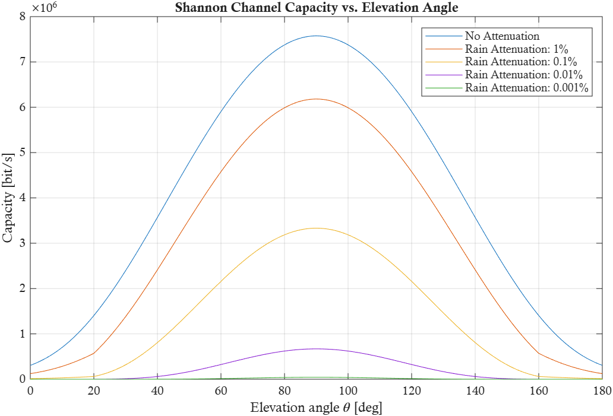
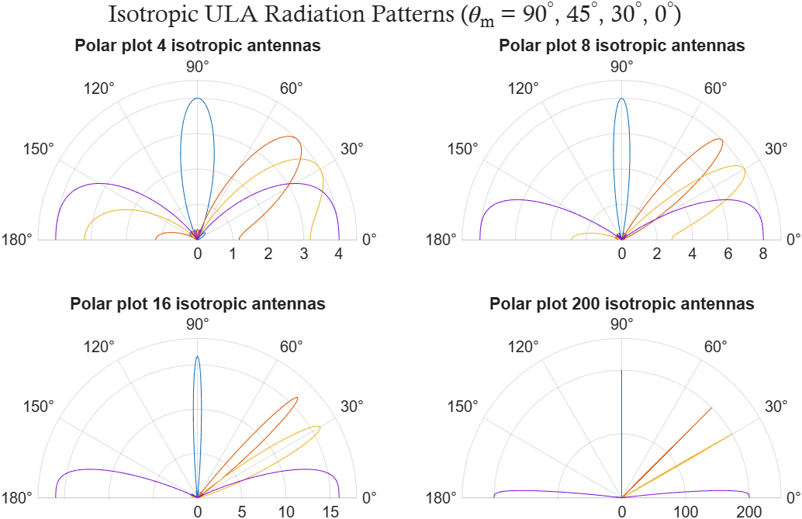
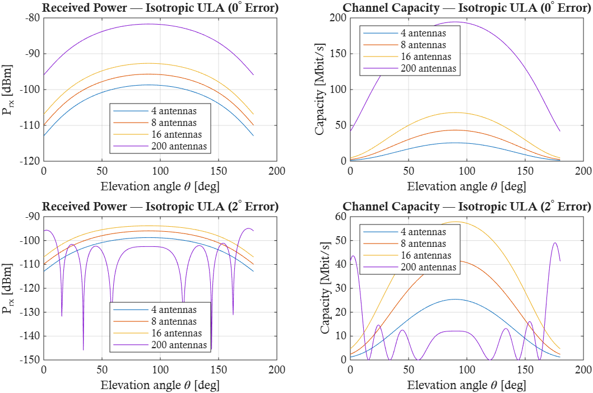
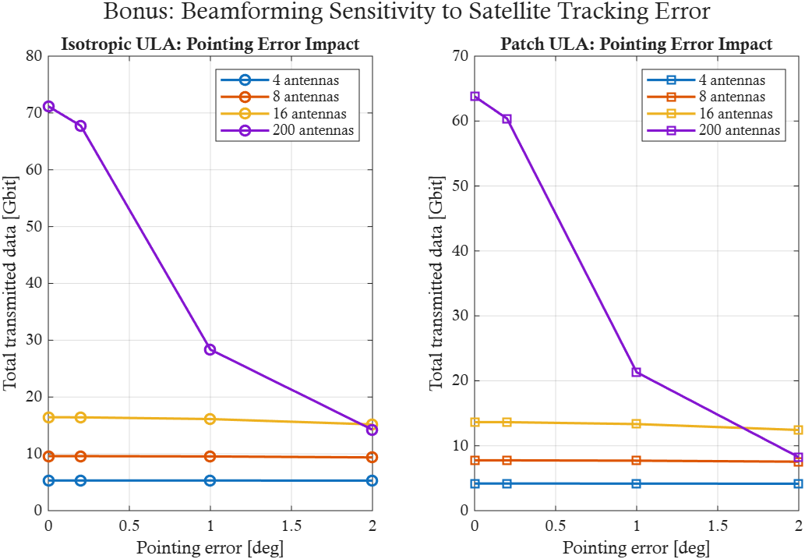
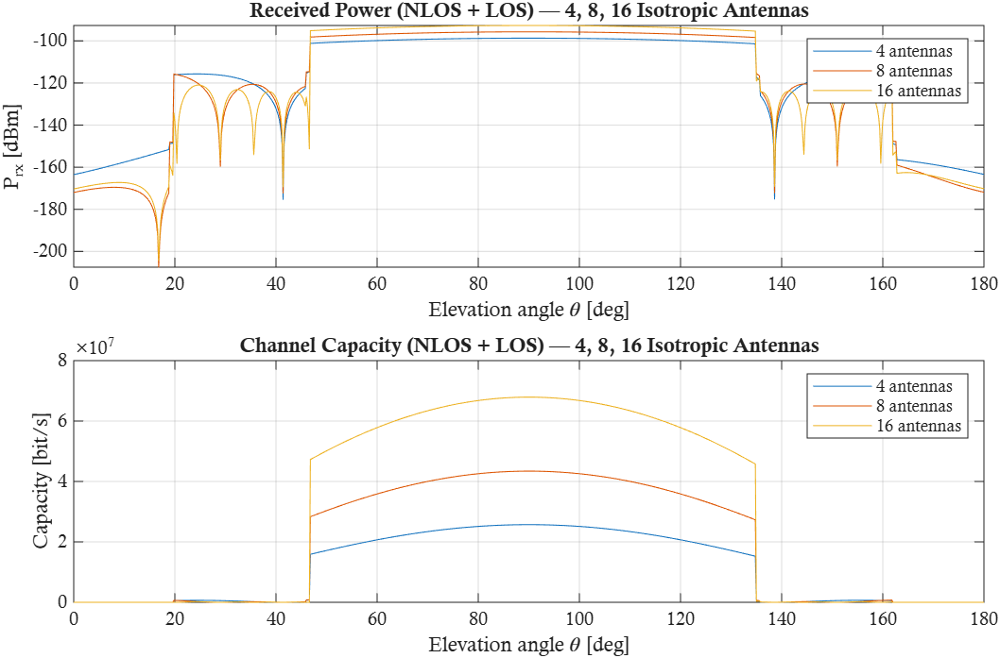

# 26 GHz mmWave LEO SatCom Beamforming & Channel Simulator

A MATLAB simulation suite modeling a **26 GHz Ka-band Low Earth Orbit (LEO) satellite downlink** (`h_s = 500 km`, `BW = 40 MHz`, `EIRP = 40 dBW`) across a full horizon-to-horizon orbital pass (`theta = 0°..180°`). The pipeline progresses from free-space link budgeting with ITU-R rain fade, to Uniform Linear Array (ULA) electronic beam-steering and pointing-error trade-offs, to an urban street-canyon NLOS/LOS reflection and knife-edge diffraction channel.

## Link & System Parameters

| Parameter | Symbol | Value |
| :--- | :---: | :--- |
| Carrier frequency | `f_c` | `26 GHz` (`lambda ≈ 11.54 mm`) |
| System bandwidth | `BW` | `40 MHz` |
| Transmitter EIRP | `EIRP` | `40 dBW` (`70 dBm` / `10 kW`) |
| Receiver noise figure / temp | `F`, `T_rx` | `2 dB`, `275 K` |
| Orbit altitude / radius / period | `h_s`, `R_E`, `T_rev` | `500 km`, `6371 km`, `5668 s` |
| ULA element spacing | `d_ant` | `lambda / 2` |

## Modules & Verified Results

1. **Free-Space Downlink, Rain Fade & Constant-Bitrate Cutoff (`src/step1_link_budget_rain.m`)**
   - Evaluates slant range `d(theta)`, ITU-style rain attenuation (`h_r = 2.4 km`, `R_0.01 = 30 mm/h`) across outage probabilities `{0%, 1%, 0.1%, 0.01%, 0.001%}`, Friis received power, SNR, and integrated Shannon capacity:
     - **Variable-rate pass volume:** `1.4643`, `0.9687`, `0.3778`, `0.0543`, `0.0027 Gbit`
     - **Constant-rate optimal volume:** `0.5338`, `0.3800`, `0.1641`, `0.0249`, `0.0013 Gbit` (optimal symmetric cutoffs: `42°`, `48°`, `56°`, `64°`, `69°`)
2. **ULA Receiver Beamforming & Pointing-Error Bonus (`src/step2_ula_beamforming.m`)**
   - Compares half-wavelength ULAs of `N = [4, 8, 16, 200]` **isotropic** (`U = U_0`) and **microstrip patch** (`U = U_0 sin^2(theta)`) elements across steering errors `[0°, 0.2°, 1°, 2°]`.
   - Under `2°` pointing error, narrow `200`-element mainlobes suffer severe sidelobe nulls (`71.17 -> 14.24 Gbit` iso; `63.80 -> 8.24 Gbit` patch), falling below the wider `16`-element array (`15.18 Gbit` iso; `12.42 Gbit` patch):

| Array Elements (`N`) | Iso `0°` [Gbit] | Iso `1°` [Gbit] | Iso `2°` [Gbit] | Patch `0°` [Gbit] | Patch `2°` [Gbit] |
| :---: | :---: | :---: | :---: | :---: | :---: |
| `4` | `5.32` | `5.31` | `5.28` | `4.18` | `4.15` |
| `8` | `9.60` | `9.54` | `9.37` | `7.75` | `7.54` |
| `16` | `16.44` | `16.12` | `15.18` | `13.64` | `12.42` |
| `200` | `71.17` | `28.35` | `14.24` | `63.80` | `8.24` |

3. **Urban Canyon Specular Reflection & Knife-Edge Diffraction (`src/step3_ground_reflection_diffraction.m`)**
   - Models `10 m` dielectric walls (`x = ±10 m`, `epsilon_r = 4`) blocking `< 19°` / `> 162°` (Fresnel diffraction), reflecting `19°–45°` / `135°–161°` (Fresnel reflection), and leaving `(45°, 135°)` LOS (`pas = 0.20°`):
     - **Single isotropic antenna:** `0.8519 Gbit`
     - **`[4, 8, 16]` Isotropic ULAs:** `2.743`, `4.629`, `7.352 Gbit` (peak `C`: `25.70`, `43.42`, `67.92 Mbit/s`)
     - **`[4, 8, 16]` Patch ULAs:** `2.825`, `4.700`, `7.406 Gbit` (peak `C`: `27.21`, `44.52`, `68.63 Mbit/s`)
   - *Runtime note:* `pas = 0.2°` executes in ~6 s. Lowering `pas = 0.02°` matches the finer grid in the original report but builds large (`9001x9001x3`) steering tensors and runs significantly slower.

## Repository Structure

```text
mmwave-leo-satcom-beamforming/
├── src/
│   ├── step1_link_budget_rain.m                 # Friis link budget, ITU rain fade, CBR optimization
│   ├── step2_ula_beamforming.m                  # Isotropic/patch ULAs, polar plots & pointing error bonus
│   └── step3_ground_reflection_diffraction.m    # Urban canyon diffraction + reflection + ULA capacity
├── docs/
│   └── figures/                                 # Verified exported MATLAB figures
├── .gitignore
├── LICENSE
└── README.md
```

## MATLAB Requirements & Quickstart

- **MATLAB:** Base MATLAB only (R2020b+ recommended; verified on R2026b — zero external toolboxes required).
```matlab
run('src/step1_link_budget_rain.m')
run('src/step2_ula_beamforming.m')
run('src/step3_ground_reflection_diffraction.m')
```

## Key Figures






