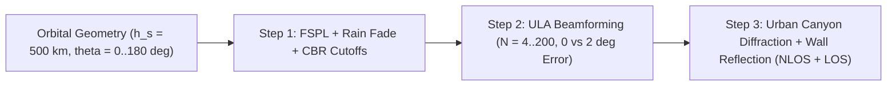
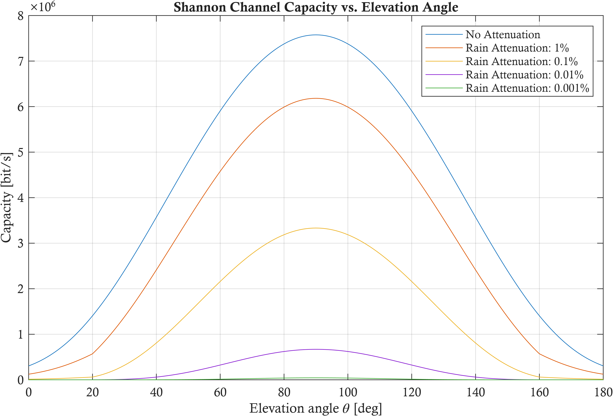
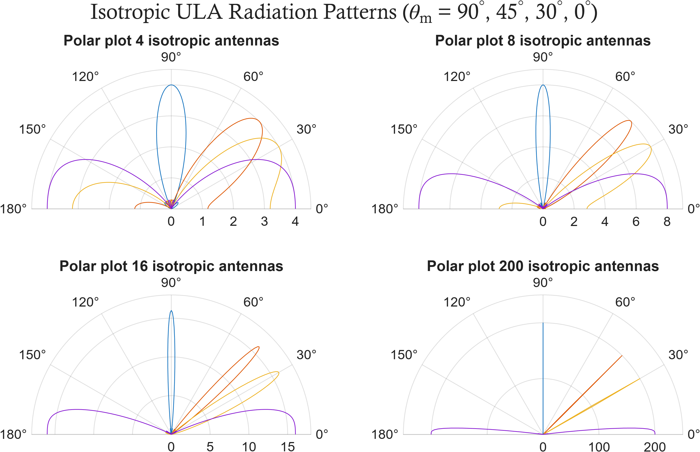
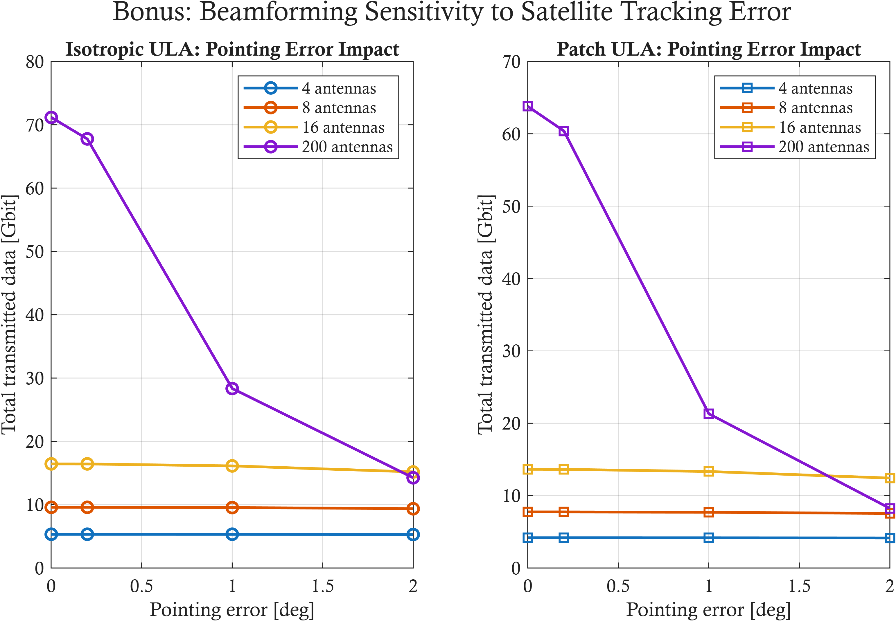
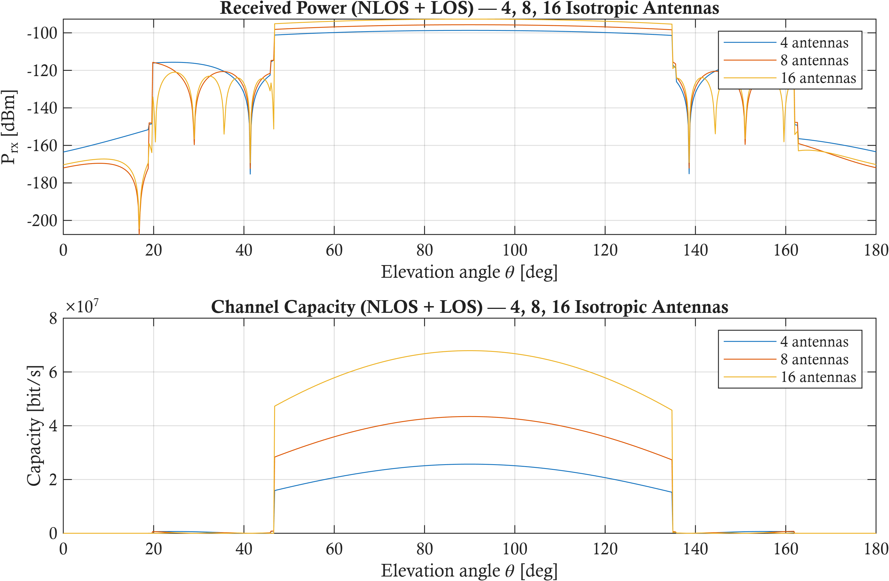

# 26 GHz mmWave LEO SatCom Beamforming & Channel Simulator

Models a 26 GHz Ka-band downlink from a 500 km circular Low Earth Orbit (LEO) satellite to a ground terminal under ITU-style rain attenuation, Uniform Linear Array (ULA) beamforming pointing errors, and urban street-canyon reflection/diffraction. Quantifies the trade-off between array directivity gain, tracking-error sensitivity, and total per-pass data volume (`Gbit/pass`).

## System & Processing Pipeline



1. **`src/step1_link_budget_rain.m`** — Computes slant range `d(theta)`, free-space path loss, ITU-style rain attenuation (`h_r = 2.4 km`, `R_0.01 = 30 mm/h`) across outage probabilities `{0%, 1%, 0.1%, 0.01%, 0.001%}`, Friis received power, SNR, and variable-rate vs. optimal constant-bitrate pass capacity.
2. **`src/step2_ula_beamforming.m`** — Evaluates half-wavelength ULAs (`N = 4, 8, 16, 200`) with isotropic (`U_0`) and microstrip patch (`U_0 sin^2(theta)`) elements across steering angles `[90°, 45°, 30°, 0°]` and pointing errors `[0°, 0.2°, 1°, 2°]`.
3. **`src/step3_ground_reflection_diffraction.m`** — Models `10 m` dielectric canyon walls (`x = ±10 m`, `epsilon_r = 4`) combining single-edge Fresnel knife-edge diffraction (`< 19°` / `> 162°`), Fresnel specular reflection (`19°–45°` / `135°–161°`), and unobstructed LOS (`45°–135°`) for single-element and `N = [4, 8, 16]` ULAs (`pas = 0.2°`).

## Key Results

Verified outputs recorded from standalone execution on MATLAB R2026b (`BW = 40 MHz`, `EIRP = 40 dBW`, `F = 2 dB`, `T_rx = 275 K`):

| Simulation Stage | Condition / Configuration | Verified Key Metric |
| :--- | :--- | :--- |
| **Step 1: Rain Fade (Variable Rate)** | Outage `0% / 1% / 0.1% / 0.01% / 0.001%` | Pass volume: `1.464 / 0.9687 / 0.3778 / 0.0543 / 0.0027 Gbit` |
| **Step 1: Rain Fade (Constant Rate)** | Optimal cutoffs `42° / 48° / 56° / 64° / 69°` | Pass volume: `0.5338 / 0.3800 / 0.1641 / 0.0249 / 0.0013 Gbit` |
| **Step 2: Isotropic ULA Pointing Error** | `N = 4 / 8 / 16 / 200` (`0° -> 2°` error) | `5.32 -> 5.28 / 9.60 -> 9.37 / 16.44 -> 15.18 / 71.17 -> 14.24 Gbit` |
| **Step 2: Patch ULA Pointing Error** | `N = 4 / 8 / 16 / 200` (`0° -> 2°` error) | `4.18 -> 4.15 / 7.75 -> 7.54 / 13.64 -> 12.42 / 63.80 -> 8.24 Gbit` |
| **Step 3: Urban Canyon (`pas = 0.2°`)** | Single antenna vs. `N = 4 / 8 / 16` Iso | `0.8519 Gbit` vs. `2.743 / 4.629 / 7.352 Gbit` (peak `25.70 / 43.42 / 67.92 Mbit/s`) |
| **Step 3: Urban Canyon (`pas = 0.2°`)** | `N = 4 / 8 / 16` Patch ULA | `2.825 / 4.700 / 7.406 Gbit` (peak `27.21 / 44.52 / 68.63 Mbit/s`) |


*Figure 1 (`step1_fig05.png`): Shannon channel capacity across elevation angles from clear-sky to 0.001% rain exceedance — [Vector PDF](docs/figures/pdf/step1_fig05.pdf).*


*Figure 2 (`step2_fig01.png`): Half-wavelength isotropic ULA polar gain patterns (`N = 4, 8, 16, 200`) steered to `90°, 45°, 30°, 0°` — [Vector PDF](docs/figures/pdf/step2_fig01.pdf).*


*Figure 3 (`step2_fig05.png`): Per-pass throughput vs. pointing error — at `2°` mismatch, the narrow `200`-element beam drops below `16` elements — [Vector PDF](docs/figures/pdf/step2_fig05.pdf).*


*Figure 4 (`step3_fig02.png`): Combined diffraction, specular wall reflection, and LOS received power/capacity for `4, 8, 16` isotropic elements — [Vector PDF](docs/figures/pdf/step3_fig02.pdf).*

## Repository Layout & Quickstart

```text
mmwave-leo-satcom-beamforming/
├── src/
│   ├── step1_link_budget_rain.m                 # FSPL, rain fade, variable vs. CBR pass optimization
│   ├── step2_ula_beamforming.m                  # Isotropic/patch ULA patterns & 0..2 deg pointing-error sweep
│   └── step3_ground_reflection_diffraction.m    # Urban canyon diffraction + Fresnel reflection + ULA capacity
├── docs/figures/
│   ├── png/                                     # 450 DPI PNG exports (all 14 figures)
│   └── pdf/                                     # True vector PDF exports (all 14 figures)
├── .gitignore
├── LICENSE
└── README.md
```

- **MATLAB & Toolboxes:** Base MATLAB only — zero external toolboxes required (verified on MATLAB R2026b).
- **Entry-Point Execution Order:**
  ```matlab
  run('src/step1_link_budget_rain.m')
  run('src/step2_ula_beamforming.m')
  run('src/step3_ground_reflection_diffraction.m')
  ```
- **Runtime Notes:** In standalone execution, `step1` runs in `~29 s` (`6` figures), `step2` in `~38 s` (`5` figures), and `step3` in `~20 s` (`3` figures) at the default angular grid `pas = 0.2°`.
  > [!WARNING]
  > Lowering `pas` to `0.02°` in `src/step3_ground_reflection_diffraction.m` constructs full `9001 x 9001 x 3` steering arrays and substantially increases execution time and memory footprint.

## Dependencies & License

- **Third-Party Dependencies:** None; all calculations use core MATLAB array operations.
- **License:** Distributed under the [MIT License](LICENSE) (`Copyright (c) 2026 Mathis Melki`).
